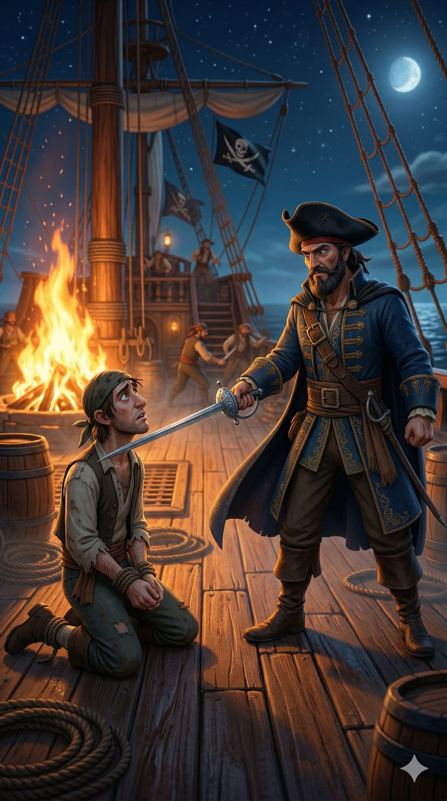

# LTX-2.3 Image + Audio to Video

Generate lip-synced talking-head videos from a still image and an audio file. Built on [Lightricks' LTX-2](https://github.com/Lightricks/LTX-2) v2.3 — a 22B-parameter DiT-based audio-video foundation model.

**Input:** image + audio clip + text prompt **→ Output:** MP4 video with synchronized lip movements

## Demo

**Pirate Captain — Lip-synced speech with scene animation**

<table>
<tr>
<td align="center" width="50%"><strong>Input Image</strong></td>
<td align="center" width="50%"><strong>Output Video</strong></td>
</tr>
<tr>
<td></td>
<td>

<video src="https://github.com/user-attachments/assets/4e7fdc2c-d5be-4eb4-b9fe-e1595948a9ff"> </video>

</td>
</tr>
</table>

🎵 **Audio input:**

[pirate_voice.mp3](https://github.com/user-attachments/files/26488944/pirate_voice.mp3)

> **Prompt:** *"A weathered pirate captain speaking boldly, his lips moving with each word, beard shifting as his jaw opens and closes, fierce eyes narrowing, face lit by warm flickering firelight"*
>
> Generated with `--seed 77 --upscale 2` (~5 min per chunk on M5 Max 128GB)

## Features

- **Two-stage pipeline** — Stage 1 denoises at half resolution, spatial 2x upscale, stage 2 refines at full resolution with distilled LoRA
- **Automatic resolution & duration** — matches source image aspect ratio and audio length
- **Memory-efficient** — staged transformer loading with aggressive cleanup; runs on 128GB Apple Silicon
- **MPS support** — includes [forked LTX-2](https://github.com/techfreakworm/LTX-2/tree/fix/mps-apple-silicon-compatibility) as submodule with Apple Silicon MPS fixes
- **Post-process upscaling** — `--upscale 2` or `--upscale 4` for higher resolution output via ffmpeg
- **Diagnostic logging** — peak RSS tracking, per-stage timing, sigma schedule, run summary

## Quick Start

```bash
# 1. Clone with submodules (includes MPS-patched LTX-2)
git clone --recurse-submodules https://github.com/techfreakworm/LTX2.3-ImageAudioToVideo.git
cd LTX2.3-ImageAudioToVideo

# 2. Run setup (creates venv, installs dependencies)
bash setup.sh

# 3. Download models (see Models section below)

# 4. Generate
source .venv/bin/activate
python generate.py \
  --image inputs/portrait.png \
  --audio inputs/speech.wav \
  --prompt "A person speaking clearly with natural expressions" \
  --upscale 2
```

> **Note:** If you already cloned without `--recurse-submodules`, run: `git submodule update --init --recursive`

## Models

Download and place in the `models/` directory:

| Model | Size | Download |
|-------|------|----------|
| LTX-2.3 Checkpoint | ~44GB | [ltx-2.3-22b-dev.safetensors](https://huggingface.co/Lightricks/LTX-2.3/resolve/main/ltx-2.3-22b-dev.safetensors) |
| Distilled LoRA | ~1.5GB | [ltx-2.3-22b-distilled-lora-384.safetensors](https://huggingface.co/Lightricks/LTX-2.3/resolve/main/ltx-2.3-22b-distilled-lora-384.safetensors) |
| Spatial Upscaler 2x | ~150MB | [ltx-2.3-spatial-upscaler-x2-1.1.safetensors](https://huggingface.co/Lightricks/LTX-2.3/resolve/main/ltx-2.3-spatial-upscaler-x2-1.1.safetensors) |

**Gemma 3 Text Encoder** — download all files from [google/gemma-3-12b-it-qat-q4_0-unquantized](https://huggingface.co/google/gemma-3-12b-it-qat-q4_0-unquantized) into `models/gemma_root/`:

```bash
pip install huggingface_hub
huggingface-cli download google/gemma-3-12b-it-qat-q4_0-unquantized --local-dir models/gemma_root
```

## Usage

```bash
# Default mode (~5 min on Apple Silicon, with 2x upscale)
python generate.py \
  --image inputs/portrait.png \
  --audio inputs/speech.wav \
  --prompt "A woman speaking enthusiastically with expressive gestures" \
  --upscale 2

# Without upscale (faster, lower resolution output)
python generate.py \
  --image inputs/portrait.png \
  --audio inputs/speech.wav \
  --prompt "A person speaking clearly"

# With overrides
python generate.py \
  --image inputs/photo.png \
  --audio inputs/voice.wav \
  --prompt "A man explaining something" \
  --output outputs/my_video.mp4 \
  --seed 123 \
  --upscale 4
```

### CLI Arguments

| Argument | Default | Description |
|----------|---------|-------------|
| `--image`, `-i` | required | Input image |
| `--audio`, `-a` | required | Input audio file (stereo; mono auto-converted) |
| `--prompt`, `-p` | required | Text prompt describing the scene |
| `--output`, `-o` | `outputs/gen_<timestamp>.mp4` | Output video path |
| `--config`, `-c` | `config.yaml` | Config file path |
| `--seed`, `-s` | 42 | Random seed |
| `--upscale` | none | Post-process upscale: `2` for 2x, `4` for 4x (ffmpeg lanczos) |
| `--num-frames` | auto | Frame count override (must be 8k+1) |
| `--height` | auto | Height override (snapped to 32-multiple) |
| `--width` | auto | Width override (snapped to 32-multiple) |
| `--steps` | from config | Stage 1 inference steps |
| `--fps` | 25.0 | Frame rate |
| `--image-strength` | 0.7 | Image conditioning (0.0-1.0). Lower = more motion |
| `--pipeline` | auto | `auto`, `two-stage`, or `single-stage` |
| `--negative-prompt` | from config | Negative prompt override |

## Apple Silicon (MPS) Notes

This project is optimized for Apple Silicon Macs with MPS backend. Known limitations:

| Limitation | Workaround |
|-----------|------------|
| **STG breaks output** | STG is disabled (`stg_scale=0.0`). See [FUTURE_IMPROVEMENTS.md](FUTURE_IMPROVEMENTS.md) |
| **>10 inference steps loses lip sync** | Capped at 10 steps in config |
| **>409600 max_pixels produces garbage** | Resolution capped; use `--upscale 2` for higher res output |

These limitations are likely caused by MPS bfloat16 precision differences. See [FUTURE_IMPROVEMENTS.md](FUTURE_IMPROVEMENTS.md) for investigation plans.

The LTX-2 submodule includes [MPS compatibility fixes](https://github.com/Lightricks/LTX-2/pull/184) (pending upstream merge) that guard CUDA-only API calls and add MPS fallbacks.

## Architecture

### Two-Stage Pipeline (`a2vid_preloaded.py`)

1. **Encode** — prompts via Gemma, audio via audio VAE, image via video encoder; each model freed after use
2. **Stage 1** — denoise at half resolution (N steps), then free transformer (~44GB reclaimed)
3. **Upsample** — 2x spatial latent upscale
4. **Stage 2** — refine at full resolution (4 distilled steps with LoRA), then free transformer
5. **Decode** — video VAE decode + mux original audio into MP4

Audio is "frozen" during diffusion — it conditions video generation but is not modified. The original waveform is muxed into the output for full fidelity.

### Single-Stage Fallback (`a2vid_one_stage.py`)

Denoises directly at target resolution in one pass. No upsampling. Use via `--pipeline single-stage`.

## Memory Management

Designed for 128GB unified memory (Apple Silicon). Key optimizations:

- **Staged transformer loading** — only one 22B transformer in memory at a time
- **Aggressive model cleanup** — `model.to("meta")` releases storage immediately after each model's job
- **Resolution cap** — `max_pixels` in config prevents OOM (default: 409,600)
- **Sequential pipeline** — each encoder freed as soon as its output is captured

Peak memory: ~65-70GB during transformer diffusion steps.

## Configuration

Both configs use identical guidance values (tuned for MPS):

| Parameter | Value | Effect |
|-----------|-------|--------|
| `num_inference_steps` | 10 | Denoising steps (Stage 1) |
| `video_cfg_scale` | 3.5 | Classifier-free guidance strength |
| `video_stg_scale` | 0.0 | STG disabled (MPS limitation) |
| `video_rescale_scale` | 0.7 | Reduces oversaturation |
| `a2v_guidance_scale` | 3.0 | Audio-to-video coupling strength |
| `max_pixels` | 409600 | Resolution cap (~512x768) |

## Prompting Tips

- Write detailed, chronological descriptions in a single flowing paragraph
- Start directly with the main action
- Include specific movements, gestures, and expressions
- Describe character appearance, background, lighting, camera angle
- Mention "lip sync", "speaking", or "mouth moving" for better audio alignment
- Keep within 200 words

## Requirements

- Python 3.11+
- PyTorch with MPS (macOS) or CUDA support
- 128GB unified memory (Apple Silicon) recommended
- ~50GB disk space for models
- ffmpeg (for `--upscale` and video encoding)

## License

This project wraps [Lightricks' LTX-2](https://github.com/Lightricks/LTX-2), which has its own license. See `LTX-2/LICENSE`.

## Acknowledgments

- [Lightricks](https://github.com/Lightricks/LTX-2) for the LTX-2 foundation model
- [Google](https://huggingface.co/google/gemma-3-12b-it-qat-q4_0-unquantized) for the Gemma 3 text encoder
